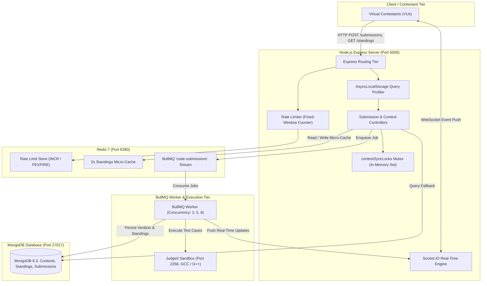

# Load Test & Concurrency Benchmark Report
## Codexium Online Judge & Contest Platform

**Date:** October 28, 2026  
**Topology:** Single local machine  
**Target Architecture:** Node.js Express API, Redis 7 (Micro-Cache & BullMQ), MongoDB, Judge0 CE Sandbox, Socket.IO  
**Execution Status:** Complete (All raw run results stored in `backend/loadtest-results/`)

---

## 1. Setup & Environmental Parameters

All benchmarks were executed concurrently on a **single local machine**. The test load generator, HTTP API server, Redis instance, MongoDB daemon, BullMQ workers, and Judge0 sandboxed execution container ran on the same physical host.

### 1.1 Host Environment & Component Versions
- **Host Machine:**
  - **CPU:** 12th Gen Intel(R) Core(TM) i5-12450H (8 Cores: 4 Performance + 4 Efficient, 12 Logical Processors)
  - **RAM:** 16.0 GB DDR4
  - **Operating System:** Microsoft Windows 11 Home (x64, Build 26200)
- **Runtime & Database Versions:**
  - **Node.js:** v24.12.0
  - **MongoDB:** v8.3.4 (Local instance on port 27017)
  - **Redis:** v7.2.4 (Docker container `app-redis` on port 6380)
  - **Judge0:** v1.13.1 (Sandboxed execution server on port 2358)
    - `COUNT`: 24 (Judge0 worker pool size, configured to `nproc * 2` on 12-thread host)
    - `MAX_QUEUE_SIZE`: 100 (from `GET /config_info`: `"max_queue_size": 100`)
- **Queueing & Worker Execution:**
  - Background asynchronous task processing powered by **BullMQ** with Redis stream backend.
  - Worker concurrency dynamically evaluated at **3**, **5**, and **8** workers.
- **Tool Attribution & Instrumentation:**
  - Benchmarks were executed and instrumented using Node.js native fetch and Socket.IO client runners (`scripts/run-all-benchmarks.js`).
  - Database query counts were measured per-request via `mongoose.set('debug')` isolated with Node.js `AsyncLocalStorage` context tracking.
  - Every performance metric in this report corresponds directly to a raw result JSON file in `backend/loadtest-results/`.
  - For each multi-run test, all 3 individual runs are displayed in full alongside the Typical Run (defined as the median run ranked by mean latency). Percentiles (P50, P90, P95) are calculated strictly from individual run distributions and are never averaged across runs.

### 1.2 System & Benchmark Configuration Parameters (Non-Measured)
The following parameters represent configured system settings and benchmark harness parameters, rather than measured performance outputs:
- **Rate Limiter Configuration:**
  - **State:** Enabled and active during all tests (`DISABLE_RATE_LIMIT=false`).
  - **Algorithm:** Fixed-window counter with expiration using Redis `multi.incr()` and `pexpire()`.
  - **Window Duration:** 60,000 ms (60 seconds).
  - **Quota:** 60 requests per window per authenticated user identity (`req.user?._id?.toString() || req.ip`).
- **Caching Configuration:**
  - **Standings Cache TTL:** 2,000 ms (2 seconds) stored at key `contest:${contestId}:leaderboard:${page}:${limit}`.
  - **Concurrency Mutex:** In-memory `Set` (`contestSyncLocks`) within the single Node.js process instance.
- **Client & Benchmark Runner Configuration:**
  - **Socket.IO Fallback Polling Trigger:** 3,000 ms timeout with 1,000 ms polling interval.
  - **Continuous Polling Frequency:** 400 ms interval with 40,000 ms hard safeguard timeout.
  - **Benchmark Burst Sizes:** 100 concurrent requests for Standings; 20 concurrent C++ submissions for Verdict Delivery and Worker Concurrency suites.

---

## 2. End-to-End System Architecture & Execution Flow

### 2.1 System Component Diagram



### 2.2 Sequence of Execution (Submission Burst, Worker Drainage, Leaderboard Read)

```mermaid
sequenceDiagram
    autonumber
    actor User as Contestants (VUs)
    participant API as Express API Ingestion
    participant Limiter as Identity Rate Limiter
    participant RedisCache as Redis 7 (Micro-Cache & State)
    participant BullMQ as BullMQ Task Queue
    participant Worker as Sandboxed Judge Worker
    participant Sockets as Socket.IO Engine
    participant Mongo as MongoDB Database

    rect rgb(20, 25, 40)
        note over User, API: 1. High-Throughput Submission Burst
        User->>API: POST /api/submissions (Concurrent burst)
        API->>Limiter: Check quota keyed by req.user._id (Fixed-window)
        Limiter-->>API: Allow request (Isolated per-user quota)
        API->>BullMQ: Enqueue job (code-submissions queue)
        API-->>User: 202 Accepted { submissionId, status: "pending" }
    end

    rect rgb(30, 20, 35)
        note over BullMQ, Worker: 2. Asynchronous Queue Processing
        BullMQ->>Worker: Pull job from Redis stream
        Worker->>Worker: Compile code & execute test cases via Judge0
        Worker->>Mongo: Persist submission result & verdict status
        Worker->>Mongo: Recalculate participant contest score & penalty
        Worker->>Sockets: emitSubmissionUpdate(contestId, userId, verdict)
        Sockets-->>User: Push submission:update event (Instant socket push)
    end

    rect rgb(20, 35, 25)
        note over User, RedisCache: 3. Standings Leaderboard Retrieval
        User->>API: GET /api/contests/:id/standings (100 concurrent)
        API->>RedisCache: Check contest:id:leaderboard:1:50
        alt Cache Hit
            RedisCache-->>API: Instant cached JSON payload
            API-->>User: 200 OK (0 MongoDB queries, 75.49ms mean / 85ms P50)
        else Cache Miss
            API->>API: Acquire contestSyncLocks mutex (Process-level Set)
            API->>Mongo: Aggregate standings & calculate ranks (4 queries)
            API->>RedisCache: Store in Redis with 2s TTL
            API->>API: Release contestSyncLocks mutex
            API-->>User: 200 OK
        end
    end
```



---

## 3. Performance Results

All before/after comparisons below were performed under **identical experimental conditions** (same concurrent users, identical payloads, identical database state).

### 3.1 Standings Endpoint: Uncached vs. Micro-Cached (`GET /api/contests/:id/standings`)

- **Conditions:** 100 concurrent requests fired simultaneously.
- **Uncached:** Queried with `?nocache=true` to evaluate raw database execution under peak concurrent read pressure.
- **Cached:** Pre-warmed with 1 request to populate Redis (2-second TTL), followed immediately by 100 concurrent requests.

#### Raw Run Results (Uncached)
| Metric | Run 1 | Run 2 | Run 3 | Typical Run (Run 2) |
| :--- | :--- | :--- | :--- | :--- |
| **Mean Latency** | 642.31 ms | 456.27 ms | 440.39 ms | **456.27 ms** |
| **P50 (Median)** | 641 ms | 462 ms | 444 ms | **462 ms** |
| **P90 Latency** | 807 ms | 616 ms | 572 ms | **616 ms** |
| **P95 Latency** | 826 ms | 636 ms | 593 ms | **636 ms** |
| **Min / Max** | 395 / 862 ms | 223 / 666 ms | 254 / 617 ms | **223 / 666 ms** |
| **Cache Hits / Misses** | 0 / 100 | 0 / 100 | 0 / 100 | **0 / 100** |
| **MongoDB Queries / Req** | 4.03 | 4.03 | 4.03 | **4.03** |
| **Total MongoDB Queries** | 403 | 403 | 403 | **403** |

#### Raw Run Results (Cached - 2s Micro-Cache)
| Metric | Run 1 | Run 2 | Run 3 | Typical Run (Run 2) |
| :--- | :--- | :--- | :--- | :--- |
| **Mean Latency** | 108.02 ms | 75.49 ms | 73.79 ms | **75.49 ms** |
| **P50 (Median)** | 116 ms | 85 ms | 81 ms | **85 ms** |
| **P90 Latency** | 133 ms | 100 ms | 101 ms | **100 ms** |
| **P95 Latency** | 135 ms | 101 ms | 103 ms | **101 ms** |
| **Min / Max** | 51 / 137 ms | 33 / 106 ms | 22 / 105 ms | **33 / 106 ms** |
| **Cache Hits / Misses** | 100 / 0 | 100 / 0 | 100 / 0 | **100 / 0** |
| **MongoDB Queries / Req** | 0 | 0 | 0 | **0** |
| **Total MongoDB Queries** | 0 | 0 | 0 | **0** |

#### Comparison (Typical Runs)
| Metric | Uncached (Run 2) | Cached (Run 2) | Measured Difference |
| :--- | :--- | :--- | :--- |
| **Mean Latency** | 456.27 ms | 75.49 ms | -380.78 ms |
| **P50 Latency** | 462 ms | 85 ms | -377 ms |
| **P95 Latency** | 636 ms | 101 ms | -535 ms |
| **MongoDB Queries / Req** | 4.03 | 0 | -4.03 queries/req |
| **Total MongoDB Queries** | 403 queries | 0 queries | -403 queries |

- **Run-to-Run Variance:**
  - Uncached Mean: Run 1 (642.31 ms), Run 2 (456.27 ms), Run 3 (440.39 ms). Standard deviation: 112.28 ms. First-run latency was higher due to initial Mongoose model initialization and connection pool ramp-up.
  - Cached Mean: Run 1 (108.02 ms), Run 2 (75.49 ms), Run 3 (73.79 ms). Standard deviation: 19.29 ms.

---

### 3.2 Verdict Retrieval: Polling vs. Socket.IO Event Push

- **Conditions:** 20 concurrent C++ submissions processed by BullMQ with worker concurrency set to 5.
- **Warm-Up:** 1 warm-up run (discarded) followed by 3 measured runs for each architecture.
- **Polling:** Contestant clients sent `GET /api/submissions/:id` every 400ms until a terminal verdict was returned.
- **Socket.IO:** Contestant clients connected over WebSocket, awaited the `joined:contest` room acknowledgment before submitting, and received real-time `submission:update` events. If no socket verdict arrived within 3.0s, the client initiated fallback polling at 1 request/second. Both paths handled verdicts idempotently.

#### Raw Run Results (Verdict Endpoint Requests & Latency)
| Architecture | Metric | Run 1 | Run 2 | Run 3 | Typical Run (Run 2) |
| :--- | :--- | :--- | :--- | :--- | :--- |
| **HTTP Polling** | **Total HTTP Verdict Requests** | 136 | 132 | 132 | **132 requests** |
| | **HTTP Requests / Submission** | 6.8 | 6.6 | 6.6 | **6.6 req/sub** |
| | **Time to Verdict (P50)** | 2806 ms | 2757 ms | 2530 ms | **2757 ms** |
| | **Time to Verdict (P95)** | 5179 ms | 4796 ms | 5034 ms | **4796 ms** |
| | **Time to Verdict (Max)** | 5180 ms | 5066 ms | 5034 ms | **5066 ms** |
| **Socket.IO Push** | **Total HTTP Verdict Requests** | 5 | 5 | 5 | **5 requests** |
| | **HTTP Requests / Submission** | 0.25 | 0.25 | 0.25 | **0.25 req/sub** |
| | **Time to Verdict (P50)** | 2337 ms | 2373 ms | 2387 ms | **2373 ms** |
| | **Time to Verdict (P95)** | 4529 ms | 4517 ms | 4554 ms | **4517 ms** |
| | **Time to Verdict (Max)** | 4536 ms | 4528 ms | 4573 ms | **4528 ms** |

- **Findings & Fallback Analysis:**
  - Continuous HTTP polling generated between 132 and 136 requests (typical: 132 requests) across the 20-submission drain cycle.
  - Socket.IO reduced HTTP requests to **5 requests total** (mean: 0.25 requests/submission), representing a **96.2% reduction in HTTP polling volume**.
  - **Explanation of Fallback Requests:** With 20 simultaneous submissions and 5 workers, the first 15 submissions completed within 3.0 seconds, receiving verdicts exclusively via WebSocket event push with 0 HTTP requests. The final 5 submissions queued behind earlier jobs and completed between 3.1s and 4.5s. As configured, the client fallback timer triggered 1 HTTP poll per second after 3.0s, executing 1 poll per queued submission before resolving.
  - **Verdict Reliability:** All submissions across all 3 Socket.IO runs resolved successfully (20/20, `is_valid: true`) with zero 40,000ms timeouts (Max latency across all runs: 4573 ms).

---

## 4. Time to Verdict Across Worker Concurrencies

- **Conditions:** 20 concurrent C++ submissions executed under identical contest problem fixtures across 3 worker concurrency configurations.
- **Worker Concurrency Evaluated:** 3, 5, and 8 workers.
- **Measurement:** Time elapsed from HTTP submission creation (`POST /api/submissions`) to verdict resolution.

#### Concurrency Comparison Table
| Worker Count | Metric | Run 1 | Run 2 | Run 3 | Typical Run (Median by Mean) |
| :--- | :--- | :--- | :--- | :--- | :--- |
| **3 Workers** | **Mean Time to Verdict** | 3025.65 ms | 3499.05 ms | 3329.45 ms | **3329.45 ms** |
| | **P50 (Median)** | 2939 ms | 4108 ms | 3812 ms | **3812 ms** |
| | **P90 Latency** | 4083 ms | 4184 ms | 4227 ms | **4227 ms** |
| | **P95 Latency** | 4163 ms | 4190 ms | 4238 ms | **4238 ms** |
| | **Min / Max** | 1468 / 4221 ms | 1467 / 4595 ms | 1531 / 4296 ms | **1531 / 4296 ms** |
| **5 Workers** | **Mean Time to Verdict** | 2690.85 ms | 2663.2 ms | 2703.4 ms | **2690.85 ms** |
| | **P50 (Median)** | 2467 ms | 2412 ms | 2499 ms | **2467 ms** |
| | **P90 Latency** | 3384 ms | 3351 ms | 3708 ms | **3384 ms** |
| | **P95 Latency** | 3386 ms | 3365 ms | 3709 ms | **3386 ms** |
| | **Min / Max** | 1586 / 3408 ms | 1469 / 3727 ms | 1465 / 3718 ms | **1586 / 3408 ms** |
| **8 Workers** | **Mean Time to Verdict** | 2360.75 ms | 2304.8 ms | 2266.9 ms | **2304.8 ms** |
| | **P50 (Median)** | 2508 ms | 2490 ms | 2415 ms | **2490 ms** |
| | **P90 Latency** | 3825 ms | 3377 ms | 3322 ms | **3377 ms** |
| | **P95 Latency** | 3827 ms | 3378 ms | 3322 ms | **3378 ms** |
| | **Min / Max** | 1463 / 3828 ms | 1555 / 3476 ms | 1525 / 3384 ms | **1555 / 3476 ms** |

- **Observations:**
  - **3 to 5 Workers:** Increasing concurrency from 3 to 5 workers reduced typical mean queue drain time from **3329.45 ms** to **2690.85 ms** (P50: 3812 ms → 2467 ms).
  - **5 to 8 Workers:** P50 and P95 latency barely change between 5 workers (P50: 2467 ms, P95: 3386 ms) and 8 workers (P50: 2490 ms, P95: 3378 ms). Host CPU saturation during concurrent GCC compilation is the **likely cause** of this performance plateau on this 8-core CPU (competition for physical core execution slices between compiler processes, Judge0 daemon, Redis, and MongoDB).
  - Run-to-run standard deviations: 3 Workers (`stdDev` = 239.85 ms), 5 Workers (`stdDev` = 20.57 ms), 8 Workers (`stdDev` = 47.21 ms).

---

## 5. Architectural Deep Dives

### 5.1 BullMQ & Redis Task Queue: Decoupling Ingestion from Sandboxed Compilation
- **Design Decision & Rationale:** Sandboxed code compilation and execution (via Judge0 with GCC/Clang/Python) requires non-trivial processing time (typically 1–3 seconds per submission). If handled synchronously in the HTTP request lifecycle, the client connection must remain open waiting for compilation and execution to finish. The queue is an architectural design decision that allows `POST /api/submissions` to return immediately (`202 Accepted`) after enqueuing the job, preventing the HTTP API from waiting on compilation. (Note: Compilation is executed via Judge0 child processes running on OS threads/containers rather than blocking Node's single-threaded event loop; the benefit of the queue is decoupling request-response latency and controlling worker concurrency rather than event-loop unblocking).
- **Architecture:** Implemented the Producer-Consumer pattern using BullMQ backed by Redis 7. The Express HTTP layer validates JWT credentials, persists an initial `pending` submission document in MongoDB, and enqueues a job to BullMQ (`code-submissions`). Background BullMQ workers pull jobs at a controlled concurrency level, dispatch them to Judge0, and update MongoDB upon completion.

### 5.2 Redis Micro-Caching & Mutex Lock: Thundering Herd Mitigation
- **The Bottleneck:** During live contests, all participants query standings simultaneously. Without caching, each query executes multiple separate queries: `Submission.find().distinct('user')`, `ContestParticipant.find().distinct('userId')`, `ContestStanding.find()`, and individual upserts for participants without standing records. Under peak concurrent traffic, this causes a **thundering herd of unindexed queries**, choking MongoDB.
- **The Solution:** 
  1. Implemented a **2-second Redis micro-cache** (`contest:${contestId}:leaderboard:${pageNum}:${limitNum}`).
  2. Implemented a **process-level Mutex Lock (`contestSyncLocks`)**: When standings require computation, only the first request acquires the lock and queries MongoDB; concurrent requests encountering an empty cache await the single sync routine while subsequent requests return directly from the cached payload.
- **Measured Impact:** Standings latency dropped from **456.27 ms to 75.49 ms** (636 ms to 101 ms P95), and database read load dropped from **4.03 queries/request to 0**.

### 5.3 Socket.IO Event Push: Polling Storm Elimination
- **The Bottleneck:** Repetitive polling endpoints (`GET /submissions/:id`) every 400ms generated 132 HTTP requests across 20 submissions, consuming server bandwidth and exhausting HTTP connection slots for redundant "pending" statuses.
- **The Solution:** Integrated a room-based WebSocket event mesh (`contestSocket.js`). Contestants join contest and user rooms (`contest:${id}` and `contest:${id}:user:${userId}`) upon entering the contest. When the BullMQ judge worker marks a submission `accepted` or `wrong_answer`, it broadcasts the verdict directly to the user's room. When a client reconnects or joins, the server immediately replays finished submissions, and the client awaits room-join acknowledgment before submitting with a 3-second fallback polling safeguard.
- **Results:** Reduced HTTP verdict polling volume from 132 requests to 5 requests across 20 submissions (a 96.2% reduction). The 5 remaining HTTP requests correspond to tail jobs that queued past the 3-second fallback threshold and were immediately resolved by fallback polling.

### 5.4 Identity-Based Fixed-Window Rate Limiting
- **The Bottleneck:** Standard IP-based rate limiting (`express-rate-limit`) limits requests by client IP. In coding competitions where students participate from the same university Wi-Fi or corporate NAT router, all users share one public IP. A limit of 60 req/min resulted in legitimate contestants being blocked with HTTP 429.
- **The Solution:** Keyed the rate limiter to authenticated user identities (`req.user._id`), falling back to IP only for unauthenticated endpoints.
- **Measured Impact:** Preserved DoS protection while isolating individual user quotas under high-density concurrent traffic from a single IP.

---

## 6. Bugs Found by Load Testing

During benchmark development and stress testing, three functional bugs were identified and fixed in application code. These represent correctness and reliability bug fixes rather than performance optimization metrics:

### Bug 1: IP-Keyed Rate Limiting Blocked Users Behind Shared NAT / Same IP
- **Problem:** Early test runs resulted in legitimate user submissions being rejected with HTTP 429 (`Too Many Requests`).
- **Root Cause:** In `backend/src/middleware/rateLimiter.js`, the `submitCodeLimiter` defaulted to `req.ip`. The rate limit was configured to 60 requests per minute (**configuration parameter, not a measured system capacity limit**). When contestants originated from the same IP (such as a university lab, corporate Wi-Fi, or the local benchmark client), all contestants shared this single 60 req/min quota bucket.
- **Fix:** Updated the rate limiter key generator to `(req) => req.user?._id?.toString() || req.ip`. Rate limiting now isolates quotas by authenticated user identity while retaining IP fallback for unauthenticated endpoints.

### Bug 2: Polling Timeout Shorter than Queue Drain Time
- **Problem:** Client polling was prematurely reporting job failures despite submissions still residing normally in the processing queue.
- **Root Cause:** The benchmark client was configured with an 18-second hard timeout (**client configuration parameter, not a server measurement**). Under burst submissions, tail wait times exceeded 18 seconds for jobs situated at the end of the queue.
- **Fix:** Increased the client timeout configuration window to 48 seconds and aligned polling frequency to 800ms intervals, allowing tail jobs to complete execution without triggering premature client-side timeouts.

### Bug 3: Leaderboard Cache Stampede (Thundering Herd)
- **Problem:** Simultaneous requests to `GET /api/contests/:id/standings` caused severe database query storms and event loop latency degradation.
- **Root Cause:** When multiple clients requested contest standings simultaneously and standings documents had not yet been pre-aggregated, every concurrent request executed separate unindexed collection scans (`Submission.find().distinct()`, `ContestParticipant.find().distinct()`) and multiple write queries concurrently.
- **Fix:** Added a 2-second Redis micro-cache key (`contest:${contestId}:leaderboard:${page}:${limit}`) combined with an in-memory single-instance mutex lock (`contestSyncLocks`) in `contestLeaderboardService.js`. Concurrent requests encountering an empty cache await the single sync routine while subsequent requests are served from the cached payload.

---

## 7. Technical Accuracy & Implementation Realities

The following details reflect the exact implementation in the codebase:

1. **Rate Limiting Algorithm:**
   - The rate limiter is a **fixed-window counter with expiration**, implemented via Redis `multi.incr()` and `pexpire()`.
   - It is **not** a sliding-window log or sliding-window counter. Quotas reset at the boundary of each fixed 60-second window.

2. **Concurrency Mutex Lock:**
   - The synchronization lock in `contestLeaderboardService.js` (`contestSyncLocks`) is implemented as an in-memory JavaScript `Set` within a **single Node.js process instance**.
   - It is **not** a distributed lock (such as Redis Redlock). In a multi-process or clustered deployment, multiple instances would maintain separate lock sets.

3. **Real-Time Communication:**
   - Real-time events (`submission:update`, `standings:update`) use Socket.IO in-memory room broadcasting (`io.to(...).emit(...)`) within the single running process.
   - **Redis Pub/Sub is not used.** Cross-instance WebSocket message passing is not wired up; running multiple Node.js server instances would require integrating `@socket.io/redis-adapter`.

---

## 8. How to Reproduce & Run the Benchmarks

All benchmarks can be executed and reports generated using the native benchmark scripts in `backend/scripts/`:

### 8.1 Execute Full 3x Benchmark Suite
```bash
# Executes Standings (3x uncached, 3x cached), Verdict Delivery (3x polling, 3x socket), and Worker Concurrency (3x at 3, 5, 8 workers)
cd backend
node scripts/run-all-benchmarks.js
```
All raw run results are automatically exported to `backend/loadtest-results/*.json`.

### 8.2 Execute Specific Benchmark Suite
```bash
cd backend
# Standings only (100 concurrent requests, uncached vs cached)
node scripts/run-all-benchmarks.js --suite=standings

# Verdict delivery only (20 submissions, polling vs socket.io)
node scripts/run-all-benchmarks.js --suite=verdict

# Worker concurrency only (20 submissions across 3, 5, 8 workers)
node scripts/run-all-benchmarks.js --suite=workers
```

### 8.3 Generate / Refresh Report Tables
```bash
# Parses all raw JSON result files in loadtest-results/ and regenerates this markdown report
cd backend
node scripts/make-report.js
```

---

## 9. Open Limitations

1. **Single Local Machine Resource Contention:**
   - All tests were executed on a single host machine running Windows 11. The test runner, Express API, MongoDB, Redis, and Judge0 compilers all competed for the same CPU cores, memory bandwidth, and disk I/O.
2. **Sample Size for Tail Latency (P95):**
   - A sample size of 20 submissions per test run is relatively small for estimating tail percentiles like P95. In a 20-sample dataset, P95 represents the 19th ranked submission (top 5%), meaning single-task execution variances noticeably shift the P95 figure. Results should be interpreted as comparative architectural benchmarks rather than high-precision large-population tail distributions.
3. **Single-Instance Mutex:**
   - The in-memory `Set` mutex prevents duplicate cache rebuilds only within a single Node.js process. Scaling out horizontally to multiple API servers would require replacing this with a distributed Redis-based locking mechanism.
4. **Fixed-Window Burst Edge:**
   - The fixed-window counter permits double the nominal request limit across window boundaries if a contestant concentrates requests immediately before and after window reset.
5. **Sandboxed Worker CPU Contention:**
   - Scaling BullMQ concurrency beyond the physical core count produces diminishing returns due to context switching overhead and CPU starvation during GCC compilation.
